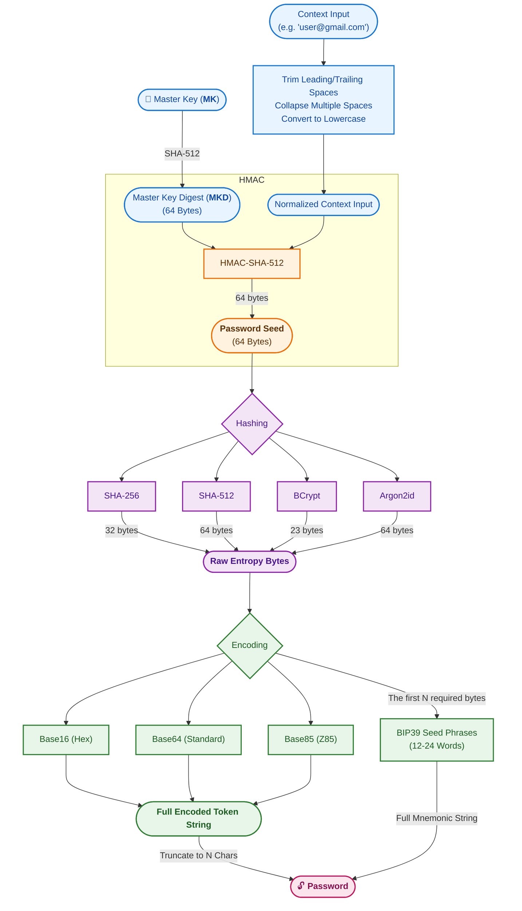

# 🔐 PassGen — Stateless Deterministic Password Generator

[](https://kotlinlang.org/)
[](https://github.com/JetBrains/compose-multiplatform)
[-green.svg?style=flat)](#-building--running-the-applications)
[](LICENSE)

**PassGen** is a modern, security-first, fully decentralized **Deterministic Password & Token Generator** built with **Kotlin Multiplatform (KMP)** and **Compose Multiplatform**.

Unlike traditional password managers that store encrypted password vaults in cloud servers or local files, **PassGen is completely stateless**. It generates strong, cryptographically secure passwords on demand using a Master Key and a contextual input (such as an account name or service URL). Given the same inputs, PassGen always produces the exact same password on any device—without ever saving passwords to disk or syncing them across networks.

---

## 💡 What PassGen Is For & The Problem It Solves

### The Problem with Traditional Password Managers
* **Vault Exposure & Data Leaks:** Storing passwords in encrypted databases (cloud or local) creates a single point of failure. If a cloud service is breached or your local database file is stolen, all your credentials are at risk.
* **Sync & Lock-in Issues:** Accessing your passwords requires sync infrastructure, cloud accounts, master password databases, or platform-specific vault applications.
* **Backup & Loss Risks:** Losing your encrypted vault backup or getting locked out of a cloud account means losing access to all your credentials permanently.

### How PassGen Solves This
PassGen adopts a **Zero-Knowledge, Stateless Architecture**:
1. **Zero Database / Zero Storage:** PassGen never saves your passwords anywhere. There is no password vault to breach, backup, or synchronize.
2. **Deterministic On-Demand Generation:** Enter your Master Key + account name (e.g., `github.com`), and PassGen dynamically derives your password using hardware-backed cryptographic key derivation functions (KDF).
3. **Cross-Device Consistency:** Re-create your exact password anywhere—on Android, iOS, Windows, macOS, Linux, or directly inside a web browser—using identical master inputs.
4. **Decentralized Security:** You only need to remember your single Master Key. Your credentials exist purely as mathematical derivations, impossible to steal from storage because they are never stored.

---

## 🛠 How PassGen Works (Cryptographic Pipeline)

PassGen offers two distinct modes of password generation: **Deterministic KDF Generation** and **Secure Random Generation**.

### 1. Deterministic KDF Pipeline (Key Derivation Function)

When generating a deterministic password, PassGen routes your Master Key and contextual input through a secure, multi-stage cryptographic pipeline:



#### Detailed Step Breakdown:
1. **Master Key Digest (MKD) Derivation:** The raw Master Key (MK) is converted into a 64-byte digest: `MKD = SHA-512(MK)`. The MKD is registered securely using platform-native secure key storage (Android Keystore with StrongBox/TEE, iOS Keychain, or secure JVM/Web memory). The raw Master Key is wiped immediately from mutable memory.
2. **Context Input Preprocessing:** Context strings (e.g., service URL or account name) pass through configurable preprocessing rules:
   * **Trim Whitespace:** Removes leading and trailing whitespace characters.
   * **Collapse Spaces:** Reduces multiple consecutive spaces into a single space.
   * **Convert Lowercase:** Converts character strings to lowercase for input consistency.
3. **Password Seed Generation:** The preprocessed context and registered MKD pass into HMAC-SHA512 to produce a 64-byte authenticated **Password Seed**:
   $$\text{Password Seed} = \text{HMAC-SHA512}(\text{Key} = \text{MKD}, \text{Message} = \text{UTF-8}(\text{Normalized Input}))$$
4. **Key Derivation & Hashing:** The Password Seed is hashed using the selected algorithm to yield raw entropy bytes:
   * **SHA-256:** Produces 32 bytes of deterministic entropy.
   * **SHA-512:** Produces 64 bytes of deterministic entropy.
   * **BCrypt:** High memory/CPU complexity (Cost 12) using a salt derived from `SHA-256(Input)`.
   * **Argon2id:** Industry gold-standard memory-hard KDF (4 iterations, 128 MB RAM, 1 parallelism thread, 64-byte output).
5. **Encoding:** The derived entropy bytes are formatted using the requested output encoder:
   * **String Encoders:** Hex (Base16), Base64, Z85 (Base85).
   * **Seed Encoders:** BIP39 Mnemonic Seed Phrases (12, 15, 18, 21, or 24 words).
6. **Truncation & Output:** String-encoded tokens are truncated to the configured `passwordLength`. Seed phrase encoders return the full mnemonic word sequence.
7. **Immediate Memory Zeroing:** All intermediate mutable byte arrays (`passwordSeed`, raw master key buffers) are cleared (`fill(0)`) immediately after execution.

---

### 2. Cryptographically Secure Random Generation Pipeline

For cases where deterministic generation is not required (e.g., creating temporary Wi-Fi passwords, one-off tokens, or fresh crypto wallet seeds):
* **Entropy Source:** Uses platform-native CSPRNG (`java.security.SecureRandom` on Android/JVM, `SecRandomCopyBytes` on iOS, `crypto.getRandomValues` on Web).
* **Configurable Output:** Supports all string and seed encoders (Hex, Base64, Z85, BIP39) with custom password length controls and live entropy/strength calculations.

---

## 🧰 Cryptographic Options Reference

### Hashing & KDF Algorithms

| Algorithm | Key / Identifiers | Parameters / Behavior | Output Entropy |
|:---|:---|:---|:---|
| **SHA-256** | `INPUT_HASHER_SHA256` | Direct SHA-256 digest of input seed | 32 Bytes (256 bits) |
| **SHA-512** | `INPUT_HASHER_SHA512` | Direct SHA-512 digest of input seed | 64 Bytes (512 bits) |
| **BCrypt** | `INPUT_HASHER_BCRYPT` | Cost factor: `12`<br/>Salt: First 16 bytes of `SHA-256(Input)` | 23 Bytes |
| **Argon2id** | `INPUT_HASHER_ARGON2ID` | Iterations: `4`<br/>Memory: `128 MB`<br/>Parallelism: `1`<br/>Salt: First 16 bytes of `SHA-256(Input)` | 64 Bytes (512 bits) |

### Encoders & Output Formats

| Encoder Class | Format | Description | Length / Word Count |
|:---|:---|:---|:---|
| **HexPassEncoder** | Base16 | Standard hexadecimal string (`0-9`, `a-f`) | Truncated to `passwordLength` |
| **Base64PassEncoder** | Standard Base64 | Alphanumeric + standard Base64 characters (`A-Z`, `a-z`, `0-9`, `+`, `/`) | Truncated to `passwordLength` |
| **Z85PassEncoder** | Base85 (Z85) | High-density ASCII text format for binary data | Truncated to `passwordLength` |
| **Bip39L12PassEncoder** | BIP39 Seed | 12 Mnemonic Words | 128-bit entropy |
| **Bip39L15PassEncoder** | BIP39 Seed | 15 Mnemonic Words | 160-bit entropy |
| **Bip39L18PassEncoder** | BIP39 Seed | 18 Mnemonic Words | 192-bit entropy |
| **Bip39L21PassEncoder** | BIP39 Seed | 21 Mnemonic Words | 224-bit entropy |
| **Bip39L24PassEncoder** | BIP39 Seed | 24 Mnemonic Words | 256-bit entropy |

---

## ✨ Features & User Experience

* **🏠 Home Screen (Deterministic Generator):**
  * Live Master Key input field with secure visibility toggles.
  * Fast context/service selection.
  * Real-time password strength meter (entropy bit calculation & strength indicators).
  * Quick copy-to-clipboard with auto-clear safety indicators.
* **🎲 Random Password & Seed Generator:**
  * One-tap generation of randomized passwords and cryptographic seed phrases.
  * Customizable encoder rules and character length sliders.
* **⚙️ PassGen Configurations & Presets:**
  * Create, edit, and save custom generation profiles.
  * Choose preferred hashing algorithm (Argon2id, BCrypt, SHA-512, SHA-256), encoder type, length, and text pre-processing rules.
* **📂 Saved Accounts / Services:**
  * Save non-sensitive account metadata (e.g., Service Name: `GitHub`, Account: `user@example.com`, Profile: `High-Security Preset`).
  * Quickly regenerate passwords for specific accounts without manually entering options every time.
* **🔒 Local Security & Biometric Lock:**
  * Protect app entry with a personal PIN / Passcode or hardware Biometrics (Fingerprint, Touch ID, Face ID).
  * Auto-lock gate on app cold start and timeout.
* **🌐 Multilingual & Adaptive UI:**
  * Built-in multi-language support: **English** and **Persian (فارسی)**.
  * Full **RTL (Right-to-Left)** and **LTR** layout direction switching.
  * Dark Mode, Light Mode, and System Theme auto-adaptation.

---

## 🏗 Modular Architecture Breakdown

PassGen follows **Clean Architecture** principles and a strict **Feature-Based Multi-Module** structure:

```
PassGen
 ├── androidApp/            # Android target launcher & platform setup
 ├── iosApp/                # iOS Xcode project hosting Compose Multiplatform
 ├── desktopApp/            # Desktop (JVM) target launcher & window configuration
 ├── webApp/                # Web targets (Kotlin/Wasm & Kotlin/JS)
 ├── composeApp/            # Aggregated shared UI, DI, and App navigation
 ├── core/
 │    ├── common/           # Cryptographic codecs (BIP39, Z85, Hex, Base64), Hasher implementations, PassGen core
 │    ├── data/             # Repositories (Settings, Accounts, Configurations, Platform HMAC Signers)
 │    ├── domain/           # Use cases (GenerateKDFPassUseCase, LocalAuth, AppConfig)
 │    ├── model/            # Business models (PassGenConfig, Password, Account, PreprocessConfig)
 │    ├── designsystem/     # Design system tokens, colors, typography, and themes
 │    ├── ui/               # Reusable Jetpack Compose components & resource bindings
 │    └── logging/          # Multiplatform logging engine
 └── feature/               # Isolated feature modules (api + impl separation)
      ├── home/             # Deterministic password generation UI & ViewModel
      ├── random/           # Random password generator UI & ViewModel
      ├── config/           # Preset configuration management UI
      ├── saved-passwords/  # Saved account profiles UI
      ├── localauth/        # Local security PIN / Password setup
      ├── unlock/           # App lock screen & Biometric verification
      ├── settings/         # App preferences (Theme, Language, Security)
      └── about/            # App metadata & version info
```

---

## 💻 Tech Stack & Open-Source Libraries

* **Language:** [Kotlin](https://kotlinlang.org/) (Multiplatform 2.4.0)
* **UI Framework:** [Compose Multiplatform](https://github.com/JetBrains/compose-multiplatform) (Material 3)
* **Dependency Injection:** [Koin](https://insert-koin.io/) & `koin-compose`
* **Navigation:** [Jetpack Navigation 3](https://developer.android.com/guide/navigation) (`androidx.navigation3`)
* **Asynchrony & State:** Kotlin Coroutines & `StateFlow`
* **Local Storage:** `multiplatform-settings` (Key-Value persistence for preferences & account metadata)
* **Serialization:** `kotlinx.serialization`
* **Cryptography:** Platform-native crypto primitives (Android Keystore, StrongBox/TEE, iOS Keychain, CommonCrypto, WebCrypto API)

---

## 🚀 Building & Running the Applications

### Prerequisites
* **Android Studio:** Jellyfish (2024.1.1) or newer with Kotlin Multiplatform plugin.
* **JDK:** Java 17 or higher.
* **Xcode:** Version 15+ (required only for building and running on iOS).

### Run Commands

#### Android
```bash
# Build & Install Debug APK
./gradlew :androidApp:installDebug
```

#### Desktop (JVM)
```bash
# Run Desktop Application
./gradlew :desktopApp:run

# Run with Hot Reload Dev Mode
./gradlew :desktopApp:hotRun --auto
```

#### Web (Kotlin/Wasm & JS)
```bash
# Run WebAssembly (Wasm) target (Modern Browsers)
./gradlew :webApp:wasmJsBrowserDevelopmentRun

# Run JavaScript target (Legacy Browsers)
./gradlew :webApp:jsBrowserDevelopmentRun
```

#### iOS
Open `iosApp/iosApp.xcworkspace` in **Xcode**, select a simulator or connected physical device, and press `Cmd + R` to run.

---

## 🧪 Running Tests

PassGen maintains test suites to ensure cryptographic consistency across platforms:

```bash
# Run unit tests across common and platform modules
./gradlew test

# Run Android instrumental UI & integration tests
./gradlew connectedAndroidTest
```

---

## 🛡️ Security Principles & Compliance

1. **Zero Password Storage:** PassGen never stores passwords. Passwords are derived on demand in memory and disappear when discarded.
2. **Memory Protection:** Sensitive byte arrays are zeroed out (`ByteArray.fill(0)`) immediately after generation to minimize exposure window in heap memory.
3. **Hardware Key Isolation:** Master Key Digest HMAC operations leverage hardware security modules (TEE / StrongBox) where available on supported mobile hardware.
4. **Stateless Portability:** You are never locked into a single app or server. As long as you know your Master Key and configuration settings, you can derive your exact passwords using any standard implementation of PassGen.

---

## 📄 License

This project is licensed under the **Apache 2.0 License** — see the repository for details.
